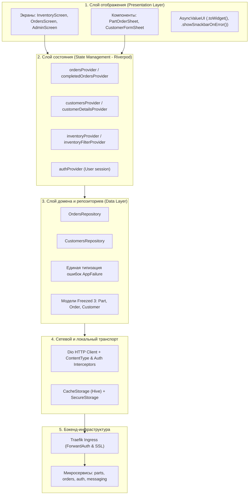
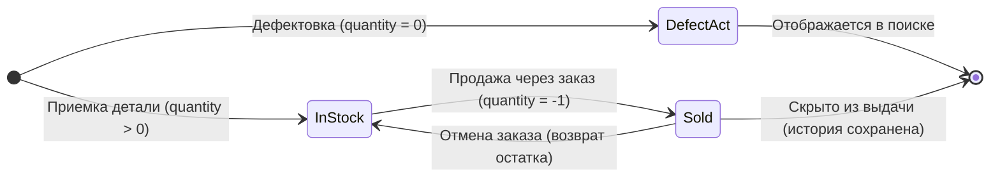

# Мобильное приложение Avtoplaneta (Flutter Client)

> 🤖 **Автоматически сгенерированная документация архитектуры и API.**
> Синхронизируется с веб-порталом документации `/readme` через `frontend/scripts/sync-docs.js`.

---

## 1. Архитектурная топология

Архитектура клиента построена по принципам **Clean Architecture** с разделением ответственности на независимые слои:



## 2. Модели данных (Freezed 3 + json_serializable)

Все основные сущности переведены на кодогенерацию **Freezed 3**, что гарантирует:
- Неизменяемость (Value Equality & HashCode).
- Автоматическую генерацию `copyWith`, `toJson`, `fromJson`.
- Отсутствие сотен строк ручного бойлерплейта.
- Изоляцию от UI (UI-хелперы и цвета вынесены в extensions).

| Модель | Назначение | Ключевые поля | Особенности |
|---|---|---|---|
| `Part` | Карточка детали склада | `id, name, price, quantity, photos, status` | Поддержка `quantity == 0` (дефектовка) и `quantity == -1` (продано) |
| `Order` | Заказ покупателя | `id, items, buyerNumber, status, paymentStatus, discount` | Цветовые статусы, вложенные `OrderItem` |
| `Customer` | Клиент (CRM) | `id, name, phone, category, discountPercent, ordersCount, totalSpent` | Автоматическая нормализация телефона к `+7XXXXXXXXXX` |
| `CustomerDetails` | Детальная карточка клиента | `customer, orders` | Расчет LTV и история всех покупок |
| `InventoryFilter` | Фильтр каталога склада | `search, category, brand, model, location, page, pageSize...` | Свыше 35 параметров фильтрации, `activeFilterCount` |

## 3. Критический доменный инвариант: учет количества (quantity)

В соответствии с [AGENTS.md](../AGENTS.md), поле `quantity` имеет строгую семантику:



- `quantity > 0` — деталь в наличии на складе.
- `quantity == 0` — дефектная ведомость / спецдеталь (**ОБЯЗАНА ОСТАВАТЬСЯ ВИДИМОЙ** в каталоге и поиске).
- `quantity == -1` — деталь полностью продана через `orders-service` (маркер сокрытия из выдачи).
- ⚠️ **ПРАВИЛО ЗАПРОСОВ:** Для фильтрации склада всегда используется условие `quantity >= 0`. Запрещено использовать `> 0`!

## 4. Единая система обработки ошибок (AppFailure)

Все сетевые и логические ошибки трансформируются в типизированный класс `AppFailure`:

| Тип ошибки | Источник | Поведение в приложении |
|---|---|---|
| `NetworkFailure` | Таймаут, отсутствие интернета, обрыв соединения | Сообщение о проверке сети, кнопка "Повторить попытку" |
| `AuthFailure` | 401 / 403 Forbidden | Предложение войти заново, автоматический переход на `/login` |
| `ValidationFailure` | 400 Bad Request, 409 Conflict | Понятный текст валидации (например: "Клиент с таким телефоном уже существует") |
| `NotFoundFailure` | 404 Not Found | "Запрашиваемый ресурс или запись не найдены" |
| `ServerFailure` | 500, 502, 503 Service Unavailable | Уведомление о сбое на стороне сервера |

## 5. Маршрутизация (GoRouter)

Навигация приложения управляется централизованно через `lib/app/router.dart`:

| Маршрут | Экран / Компонент | Доступ |
|---|---|---|
| `/login` | `LoginScreen` | Публичный |
| `/inventory` | `InventoryScreen` | Авторизованный |
| `add` | `AddPartScreen` | Авторизованный |
| `defect-report` | `DefectReportScreen` | Авторизованный |
| `/orders` | `OrdersScreen` | Авторизованный |
| `/statistics` | `StatisticsScreen` | Авторизованный |
| `/messages` | `MessagingScreen` | Авторизованный |
| `/admin` | `AdminScreen` | Администратор |
| `logs` | `AppLogsScreen` | Администратор |

## 6. Каталог API Эндпоинтов (`ApiEndpoints`)

Все обращения к бэкенду используют строго централизованный каталог маршрутов в `lib/core/api/api_endpoints.dart`:

| Название константы / метода | URL Эндпоинта | Тип вызова |
|---|---|---|
| `ApiEndpoints.orders` | `/api/v1/orders` | Статический |
| `ApiEndpoints.completedOrders` | `/api/v1/orders?state=completed` | Статический |
| `ApiEndpoints.orderById` | `/api/v1/orders/$id` | Параметризованный |
| `ApiEndpoints.completeOrder` | `/api/v1/orders/$id/complete` | Параметризованный |
| `ApiEndpoints.orderItems` | `/api/v1/orders/$orderId/items` | Параметризованный |
| `ApiEndpoints.customers` | `/api/v1/orders/customers` | Статический |
| `ApiEndpoints.customerById` | `/api/v1/orders/customers/$id` | Параметризованный |
| `ApiEndpoints.parts` | `/api/v1/parts` | Статический |
| `ApiEndpoints.partById` | `/api/v1/parts/$id` | Параметризованный |
| `ApiEndpoints.partItem` | `/api/v1/parts/item/$id` | Параметризованный |
| `ApiEndpoints.duplicatePart` | `/api/v1/parts/$id/duplicate` | Параметризованный |
| `ApiEndpoints.partCatalog` | `/api/part-catalog` | Статический |
| `ApiEndpoints.vehicleCatalog` | `/api/vehicle-catalog` | Статический |
| `ApiEndpoints.defectReports` | `/api/defect-reports` | Статический |
| `ApiEndpoints.uploadPartPhoto` | `/api/uploadpartphoto/$partId` | Параметризованный |
| `ApiEndpoints.statistics` | `/api/v1/statistics` | Статический |
| `ApiEndpoints.authMe` | `/auth/me` | Статический |
| `ApiEndpoints.authLogin` | `/auth/login` | Статический |
| `ApiEndpoints.authLogout` | `/auth/logout` | Статический |
| `ApiEndpoints.authRefresh` | `/auth/refresh` | Статический |
| `ApiEndpoints.adminUsers` | `/api/v1/admin/users` | Статический |
| `ApiEndpoints.adminUserById` | `/api/v1/admin/users/$id` | Параметризованный |
| `ApiEndpoints.adminSupplierCodes` | `/api/v1/admin/supplier-codes` | Статический |
| `ApiEndpoints.adminStatus` | `/api/v1/admin/status` | Статический |
| `ApiEndpoints.adminLogs` | `/api/v1/admin/logs` | Статический |
| `ApiEndpoints.adminUserActivityLogs` | `/api/v1/admin/user-activity-logs` | Статический |
| `ApiEndpoints.conversations` | `/api/messaging/conversations` | Статический |
| `ApiEndpoints.messagingUsers` | `/api/messaging/users` | Статический |
| `ApiEndpoints.dromDialogs` | `/api/messaging/drom/dialogs` | Статический |
| `ApiEndpoints.dromMessages` | `/api/messaging/drom/messages` | Статический |
| `ApiEndpoints.dromAuthStatus` | `/api/messaging/drom/auth/status` | Статический |
| `ApiEndpoints.dromAuthLogin` | `/api/messaging/drom/auth/login` | Статический |
| `ApiEndpoints.dromAuthSession` | `/api/messaging/drom/auth/session` | Статический |

## 7. Справочник команд для разработчика

```shell
# 1. Установка зависимостей:
flutter pub get

# 2. Генерация моделей Freezed и json_serializable:
dart run build_runner build --delete-conflicting-outputs

# 3. Генерация актуальной документации архитектуры:
dart run tool/generate_docs.dart

# 4. Проверка статического анализатора (чистый линт):
flutter analyze

# 5. Запуск всех тестов приложения:
flutter test

# 6. Сборка debug APK:
flutter build apk --debug
```

